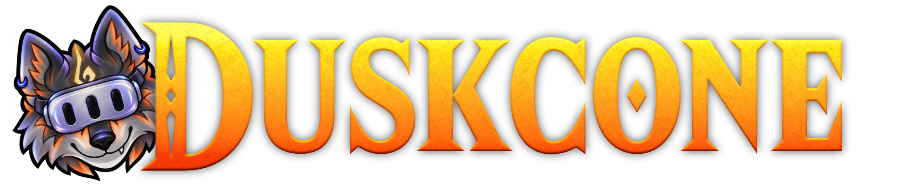

  

  

    <a href="https://twilitrealm.dev/">Official Website</a>
  

# Duskcone

Duskcone brings Twilight Princess to Meta Quest, based on [Dusklight](https://github.com/TwilitRealm/dusklight). It supports
Quest 2, Quest 3, and Quest 3S.

This repository currently hosts builds and releases. Source code will be
published here later.

## Downloads

Get the signed Quest APK from [Releases](https://github.com/qwtel/duskcone/releases).
Release candidates are marked as prereleases.

You must provide your own game dump. Game assets are not included.

## Credits

Special thanks to the [TwilitRealm](https://github.com/TwilitRealm) team for
[Dusklight](https://github.com/TwilitRealm/dusklight), and the
[Aurora](https://github.com/encounter/aurora) developers.

 

  

